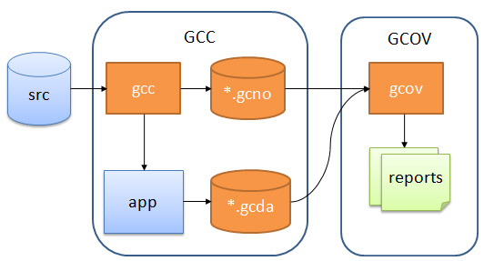

# Gcov Example

**Use [Gcov](https://gcc.gnu.org/onlinedocs/gcc/Gcov.html) + [LCOV](https://github.com/linux-test-project/lcov) / [gcovr](https://github.com/gcovr/gcovr) to show C/C++ projects code coverage results.**

[](https://github.com/shenxianpeng/gcov-example/actions/workflows/build.yml)
[](https://github.com/shenxianpeng/gcov-example/actions/workflows/cpp-linter.yml)

This repo shows how to use Gcov to create lcov/gcovr coverage reports for C/C++ projects.

📝 Read the write-up: [English](https://shenxianpeng.dev/posts/2021/gcov-example/) · [中文](https://shenxianpeng.dev/zh-cn/posts/2021/gcov-example/)

**Code coverage reports online**

* 📊 [LCOV - code coverage report](https://shenxianpeng.dev/gcov-example/lcov-report/index.html)
* 📊 [gcovr - code coverage report](https://shenxianpeng.dev/gcov-example/gcovr-report/coverage.html)
* 📊 [LCOV - merged report of two build configurations](https://shenxianpeng.dev/gcov-example/merged-report/index.html)
* 📊 [LCOV - trigger.c only (filtered report)](https://shenxianpeng.dev/gcov-example/trigger-report/index.html)

Note: The source code is under the `master` branch, and code coverage report under branch `coverage`.

## What problem does Gcov solve

The problem I encountered: A C/C++ project from decades ago has no unit tests, only regression tests. But I want to know:

* What code is tested by regression tests? 
* Which code is untested?
* What is the code coverage? 
* Where do I need to improve automated test cases in the future?

Can code coverage be measured without unit tests? The answer is Yes.

Commercial tools such as Squish Coco and Bullseye can measure the coverage of black-box tests the same way: they instrument the code at build time. I tried Squish Coco first, ran into build issues I could not resolve, and then realised that GCC ships its own instrumentation: Gcov. See [Other C/C++ coverage tools](#other-cc-coverage-tools) for how they compare.

## How Gcov works

Gcov workflow diagram



There are three main steps:

1. Adding special compile options to the GCC compilation to generate the executable, and `*.gcno`.
2. Running (testing) the generated executable, which generates the `*.gcda` data file.
3. With `*.gcno` and `*.gcda`, generate the report. lcov and gcovr run `gcov` internally and turn its output into HTML. Running `gcov` yourself only writes annotated `*.c.gcov` text files for reading in a terminal; lcov and gcovr do not read those files.

Here's how each of these steps is done exactly.

## Getting started

You can clone this repository and run `make help` to see how to use it.

```bash
$ git clone https://github.com/shenxianpeng/gcov-example.git
$ cd gcov-example

$ make help
help                           Makefile help
build                          Make build
coverage                       Run code coverage
lcov-report                    Generate lcov report
gcovr-report                   Generate gcovr report
deps                           Install dependencies (requires Debian/Ubuntu for apt-get)
build-config1                  Build with -DTRIGGER_ON into build/config1 (multi-config demo)
build-config2                  Build without TRIGGER_ON into build/config2 (multi-config demo)
coverage-merged                Merge coverage of both configurations into one report
coverage-filter                Show coverage for trigger.c only (file-specific filtering)
clean                          Clean all generate files
lint                           Lint code with clang-format
```

Steps to generate code coverage reports

```bash
# 1. compile
make build

# 2. run executable
./main

# 3. (optional) print a per-file summary and write annotated *.c.gcov text files
make coverage

# 4. generate the HTML report (lcov and gcovr run gcov themselves)
# install lcov and gcovr first
make deps
# then
make lcov-report
# or
make gcovr-report
```

## Advanced: Merging coverage from multiple build configurations

Real-world projects often compile the same source with different macros (feature flags, platform switches, etc.). You can combine the coverage from multiple configurations into a single report.

`trigger.c` demonstrates this with an `#ifdef TRIGGER_ON` / `#else` block, and `main.c` calls `trigger_action()`. A single build can only ever execute one of the two branches, because the other one is not even compiled:

```bash
# Build and run both configurations, then merge into one report
make coverage-merged
# => merged-report/index.html
```

| Build | `trigger.c` lines hit |
|-------|-----------------------|
| `build/config1` (`-DTRIGGER_ON`) | 3 of 3 |
| `build/config2` (default) | 3 of 3 |
| merged | 4 of 4 |

Each configuration alone reports 100% and hides the untested branch. Only the merged report sees both.

Each configuration is built into its own directory (`build/config1`, `build/config2`). This is not optional: GCC stamps every `.gcno` with the compile time, so when two configurations share a directory the second build overwrites the `.gcno` files, and the `.gcda` written by the first binary no longer matches them (`stamp mismatch with notes file`).

Under the hood, this uses `lcov --add-tracefile` to merge two separate `.info` files:

```bash
lcov --capture --directory build/config1 --output-file config1.info
lcov --capture --directory build/config2 --output-file config2.info
lcov --add-tracefile config1.info --add-tracefile config2.info --output-file merged.info
genhtml merged.info --output-directory merged-report
```

## Advanced: File-specific coverage filtering

To see coverage for a single file (e.g. `trigger.c`) rather than the whole project:

```bash
# First generate the full lcov report, then filter to trigger.c only
make coverage-filter
# => trigger-report/index.html
```

Using `lcov --extract` directly:

```bash
lcov --extract lcov-report/coverage.info "$(pwd)/trigger.c" --output-file trigger_only.info
genhtml trigger_only.info --output-directory trigger-report
```

With gcovr, use `--filter`:

```bash
gcovr --filter trigger.c --html --html-details -o trigger-report/coverage.html
```

## Other C/C++ coverage tools

This repository stays focused on Gcov with LCOV and gcovr. For context, these are the other tools you will run into:

| Tool | License | Compilers / platforms | Metrics | Notes |
|------|---------|-----------------------|---------|-------|
| [Gcov](https://gcc.gnu.org/onlinedocs/gcc/Gcov.html) + [LCOV](https://github.com/linux-test-project/lcov) / [gcovr](https://github.com/gcovr/gcovr) | free (GPL / BSD) | GCC; Clang through `llvm-cov gcov` | line, function, branch; condition (MC/DC) with GCC 14 `-fcondition-coverage` | what this repository shows |
| [llvm-cov source-based coverage](https://clang.llvm.org/docs/SourceBasedCodeCoverage.html) | free (Apache 2.0) | Clang only | line, region, branch, MC/DC (`-fcoverage-mcdc`) | `-fprofile-instr-generate -fcoverage-mapping`; gcovr 8.4+ and LCOV's `llvm2lcov` can import its output |
| [OpenCppCoverage](https://github.com/OpenCppCoverage/OpenCppCoverage) | free (GPL) | MSVC on Windows | line | works from PDB debug info, no instrumentation at build time; Cobertura XML and HTML output |
| [Squish Coco](https://www.qt.io/product/quality-assurance/coco) | commercial | GCC, Clang, MSVC, many embedded toolchains | line, branch, condition, MC/DC, function | instruments at build time; aimed at safety-critical projects |
| [Bullseye Coverage](https://www.bullseye.com/) | commercial | GCC, Clang, MSVC, embedded | function, condition/decision | instruments at build time; the oldest of the commercial tools |

## Related projects

Other tools I maintain for C/C++ CI:

* [cpp-linter-action](https://github.com/cpp-linter/cpp-linter-action): clang-format and clang-tidy on every pull request, the other half of the CI in this repository.
* [cpp-linter-hooks](https://github.com/cpp-linter/cpp-linter-hooks): the same checks as pre-commit hooks, before the code leaves your machine.
